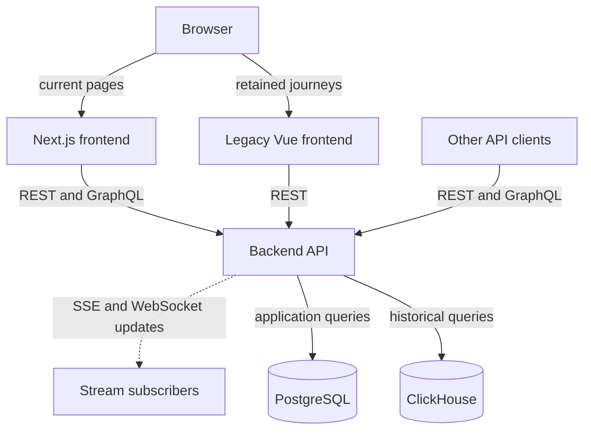
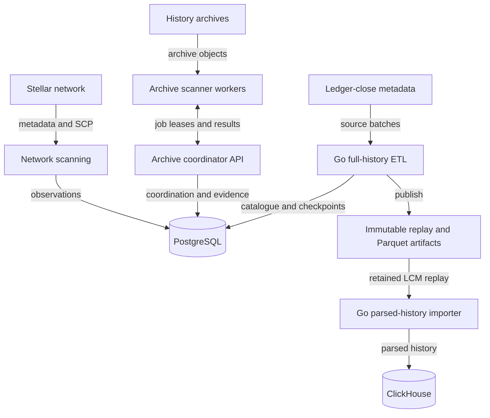
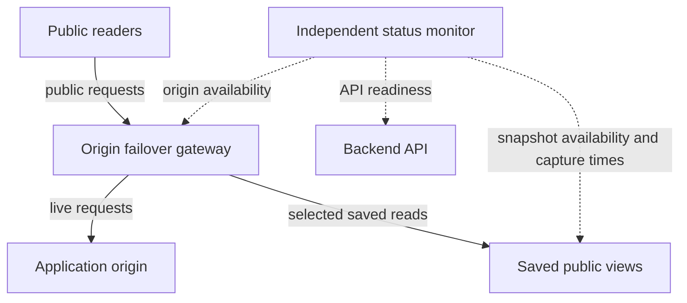

# StellarAtlas

StellarAtlas is a Stellar network intelligence and observability platform. It
combines validator and organization monitoring, quorum and SCP analysis, history
archive verification, and an explorer over ingested ledger data.

Use the [website](https://stellaratlas.io), [developer guides](https://stellaratlas.io/docs),
and [public OpenAPI schema](https://api.stellaratlas.io/docs/openapi.json) for the
public application and API contracts.

## Components and data flow

| Component | Role |
| --- | --- |
| [Next.js frontend](apps/frontend-v4) | Current React application, explorer, network and archive views, and generated API documentation. |
| [Legacy Vue frontend](apps/frontend) | Retained Vite application and compatibility journeys, including legacy notification screens. |
| [Backend API](apps/backend) | TypeScript/Express API with REST and GraphQL reads, network SSE and WebSocket streams for network, status and warehouse updates. |
| [Network scanning](apps/backend/src/network-scan) | Collects validator and organization observations, metadata and SCP evidence using the shared crawler and node connector. |
| [Archive coordinator](apps/backend/src/history-scan-coordinator) and [scanner workers](apps/history-scanner) | Assign archive verification jobs, track leases and progress, and persist evidence and results. Workers run separately and report through the coordinator API. |
| [Full-history ETL](apps/full-history-etl) | Go validation and conversion of ledger-close metadata into immutable range artifacts, including lossless XDR/Zstandard replay and typed Parquet projections. |
| [Parsed-history importer](apps/hubble-etl) | Go workers ingest retained ledger-close metadata into the ClickHouse warehouse used by explorer queries. |
| [Users service](apps/users) and [notifications](apps/backend/src/notifications) | Subscription, confirmation and email-delivery support with explicit service configuration. |

The diagrams show logical connections implemented in this repository. They do
not assert that every optional component is enabled in a particular deployment.

**Application requests and streams**



**Collection and ingestion**



Network observations and archive scan results feed PostgreSQL-backed API views.
The history pipeline validates source batches, publishes artifacts and catalogue
metadata, and advances recorded coverage. ClickHouse supplies parsed historical
queries to the API, which serves the frontend and other clients.

- **PostgreSQL** holds application records, scan coordination and evidence,
  history catalogue/checkpoints, and configured identity and verification state.
- **Parquet and replay artifacts** provide immutable batch downloads and inputs
  for offline processing. Their manifests identify schemas, source ranges and
  hashes.
- **ClickHouse** holds the analytical warehouse populated by the parsed-history
  importer. API results expose the relevant coverage, observation or watermark
  information.

History coverage and supported datasets vary by pipeline and endpoint. Check
returned ranges, freshness and completeness fields before using a result as
network-wide or current-state evidence. The [ETL contract](apps/full-history-etl/README.md)
explains artifact representations and opt-in formats.

## Availability and trust boundaries

The independently hosted [status site](ops/cloudflare/status) records sampled
readiness checks and incident history. The [origin failover gateway](ops/cloudflare/origin-failover)
can serve selected saved public reads. Saved data carries capture times and has
limited route and data coverage. See the [public status page](https://status.stellaratlas.io).



Dashed arrows in this view are checks. The status monitor records observations;
it does not route application traffic. Saved views are a limited fallback, with
their own capture times, rather than a second live ingestion system.

[Account verification and developer authentication](apps/backend/src/status/infrastructure/verification)
require their explicit configuration, authentication and review boundaries.
GitHub sign-in support requires provider credentials and validated ingress.
Directory evidence, account-control verification and signed contract build
attestations answer different questions. The contract catalogue reports stored
build observations. Independent reproduction and security-audit assessments
remain explicit in the response.

[Self-hosted analytics](ops/analytics/README.md) uses Plausible Community Edition
for browser pageviews/product actions and API-request events. Its validated event
receivers and protected dashboards have separate privacy and measurement contracts.
Browser opt-out/GPC handling and API request-count semantics are documented in
the [traffic contract](ops/analytics/TRAFFIC.md).

Optional integrations and feature flags require their own configuration and
qualification. A tracked implementation does not establish its activation or
complete data coverage. The [builders SDK plan](docs/builders-sdk-plan.md) remains
a design proposal. Dated roadmap and release documents describe their stated
milestones rather than the current runtime inventory.

## Development

For a new installation, follow the [from-scratch deployment guide](deployment.md).

Use Node.js **26.x** and pnpm **10.12.1**, as declared in
[package.json](package.json). Go components declare their toolchains separately
in their `go.mod` files. The pnpm workspace contains the TypeScript applications
and shared packages. Backend compilation uses TypeScript project references.
Next.js and legacy Vue have separate build scripts.

Prepare an isolated checkout with local service configuration. Start from the
backend [environment template](apps/backend/.env.dist) and the Next.js
[environment example](apps/frontend-v4/.env.example), supplying your own local
database connection and application settings. Keep credentials outside source.
The [devcontainer configuration](.devcontainer) provides an optional starting
point for tooling and PostgreSQL.

```sh
pnpm install --frozen-lockfile
pnpm build:ts
pnpm build:frontend-v4:staging
```

Review pending backend migrations with `pnpm migrations:backend`. Applying them
is a separate explicit command, `pnpm migrations:backend:apply`, after reviewing
the target database and migration set.

For the configured API and Next.js staging build, use separate terminals.

```sh
pnpm start:api
pnpm start:frontend-v4:staging
```

The tracked Next.js `dev` script directs development to production-mode staging
builds. Root `pnpm dev` and `pnpm start:frontend` target the legacy Vue application.
Next.js staging and production use separate build directories and release
commands. Inspect [its scripts](apps/frontend-v4/package.json) when choosing a
build, start, promotion or rollback operation.

Use `pnpm run` to list root commands. Common checks include `pnpm lint`,
`pnpm test:unit:backend` and `pnpm test:unit:frontend`. Integration tests require
configured test services, including a separate PostgreSQL database. Scanners,
ingestion workers, email delivery and optional integrations have their own
configuration and resource requirements. Run those components deliberately
rather than treating a frontend start command as a full deployment.

Shared [DTOs and graph utilities](packages/shared), the [crawler](packages/crawler),
[node connector](packages/node-connector), and [SCP simulation](packages/scp-simulation)
are maintained in the same repository. The project is licensed under
[MIT](license), with component-specific attribution where included.
